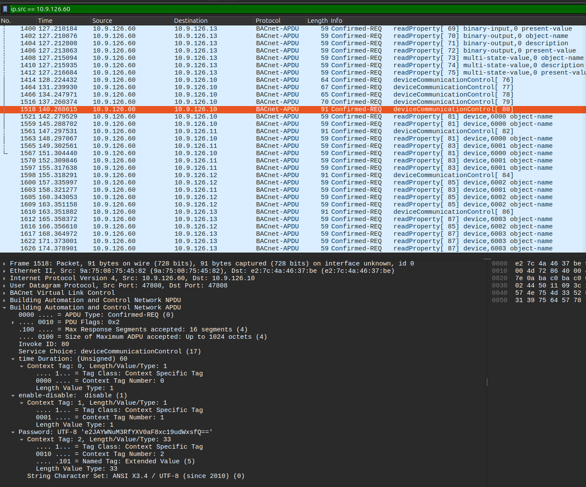

# ICS PCAP Analysis


- `10.9.126.60` sus ip
- `deviceCommunicationControl` to authenticate (brute force)
- password: 
```
ubuntu@ubuntu:~/Downloads$ printf 'e2JAYWNuM3RfYXV0aF8xc19udWxsfQ==' | base64 -d
{b@acn3t_auth_1s_null}ubuntu@ubuntu:~/Downloads$ 
```
- names can be found in `readProperty`