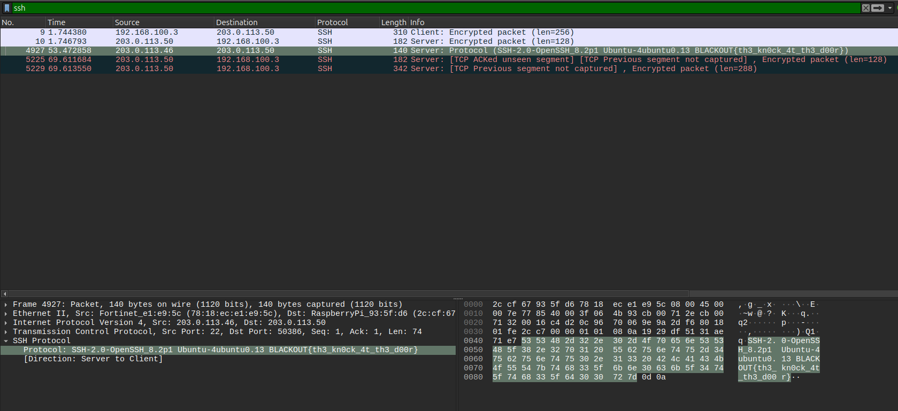
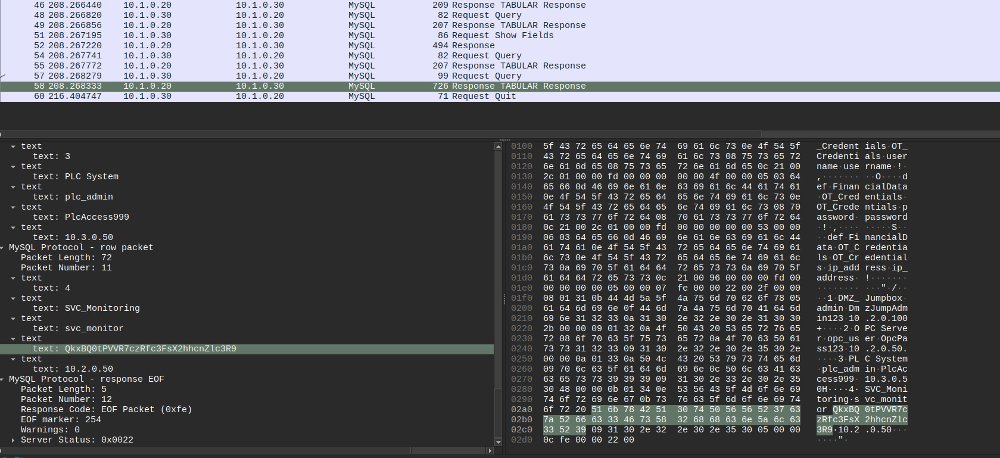
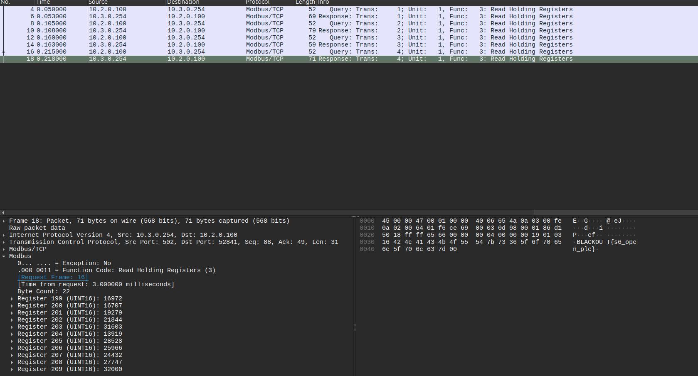

# Project Blackout
## KnockAtTheDoor


## Spare Key Under the Mat
From the log:
```
Sep 17 15:45:04 file01 blackout-canary: INTRUSION DETECTED: weak-credential SSH login - user=operator from=203.0.113.50 service=sshd flag=BLACKOUT{s2_weak_creds_pwned}
```

## Tunnel Vision
From meterpreter log:
```
BLACKOUT{s3_pivot_eternal}
```

## The Cat's Out of the Bag


- Readout of table `OT_Credentials`
- Password is base64 encoded: `BLACKOUT{s4_sql_harvest}`

## Flow State
- From the `nodered_flows_2.json`:
```json
  {
    "id": "processData1",
    "type": "function",
    "z": "f1abc123",
    "name": "Process PLC Data",
    "func": "// System ID: QkxBQ0tPVVR7czVfbm9kZV9waXZvdH0=\n// CLICK PLC Data Processor v1.2\n// Author: SCADA_SVC\n\nvar registers = msg.payload.data;\nvar output = {};\n\n// Tank level sensor (holding register 100)\noutput.tank_level = (registers[0] * 0.1).toFixed(1);\n\n// Pump A status (holding register 101)\noutput.pump_a = registers[1] === 1 ? \"RUNNING\" : \"STOPPED\";\n\n// Pump B status (holding register 102)\noutput.pump_b = registers[2] === 1 ? \"RUNNING\" : \"STOPPED\";\n\n// Process temperature (holding register 103, scaled x0.01)\noutput.temperature = (registers[3] * 0.01).toFixed(2);\n\n// Valve position 0-100% (holding register 104)\noutput.valve_pos = registers[4];\n\nmsg.payload = output;\nmsg.topic = \"plc/tank\";\nreturn msg;",
    "outputs": 1,
    "noerr": 0,
    "initialize": "",
    "finalize": "",
    "libs": [],
    "x": 490,
    "y": 200,
    "wires": [
      [
        "mqttOut1",
        "debugNode1"
      ]
    ]
  },

```

Base64 `QkxBQ0tPVVR7czVfbm9kZV9waXZvdH0=` -> `BLACKOUT{s5_node_pivot}`

## Open Book
From modbus package



## Operator Access Only
Directly in the provided screenshot.

## Loose Lips
Password in HTTP basic auth as base 64

## Sink Ships
Flag in the HTTP answer to the auth.

## Don't Breathe it in
In a modbus package.

## Lights Out
